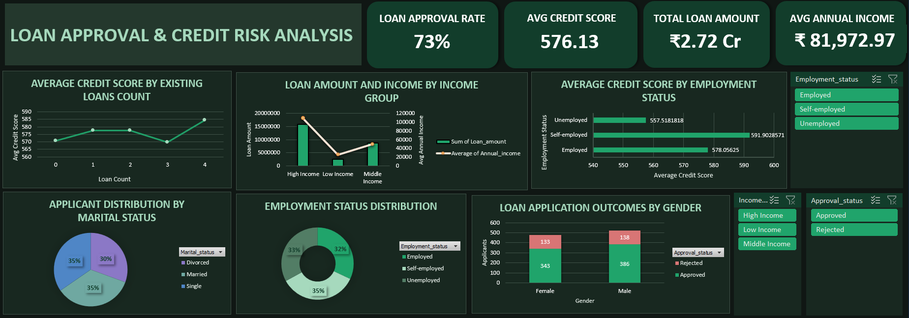

# Loan Approval Analysis Dashboard – Microsoft Excel

## Project Overview

This project focuses on analysing loan applicant data and developing an interactive dashboard using Microsoft Excel.

The dashboard provides insights into loan application outcomes and applicant characteristics, including annual income, loan amount, credit score, employment status, gender and marital status.

The objective is to transform raw applicant data into meaningful information through data analysis and interactive visualizations.

## Dashboard Preview

## Project Objectives

- Analyse loan approval and rejection patterns.
- Examine applicant financial and demographic information.
- Understand the distribution of applicants across different categories.
- Explore the relationship between credit scores and existing loans.
- Identify patterns in loan amounts across different income groups.
- Build an interactive dashboard to support data exploration.

## Tools and Technologies

- **Microsoft Excel**
- Pivot Tables
- Pivot Charts
- Slicers
- Excel Formulas
- Data Cleaning and Formatting

## Dataset Overview

The dataset contains 1,000 loan applicant records with demographic and financial information.

### Dataset Attributes

| Column | Description |
|---|---|
| Applicant ID | Unique identification number of each applicant |
| Age | Age of the applicant |
| Gender | Gender of the applicant |
| Marital Status | Marital status of the applicant |
| Annual Income | Annual income of the applicant |
| Loan Amount | Loan amount requested |
| Credit Score | Credit score of the applicant |
| Number of Dependents | Number of dependents |
| Existing Loans Count | Number of existing loans |
| Employment Status | Employment category |
| Loan Approved | Loan approval status (1 = Approved, 0 = Rejected) |

## Key Performance Indicators (KPIs)

The dashboard includes four key performance indicators:

| KPI | Value |
|---|---:|
| Loan Approval Rate | 72.9% |
| Average Credit Score | 576.125 |
| Total Loan Amount | ₹2,72,44,866 |
| Average Annual Income | ₹81,972.97 |

These KPIs provide a quick overview of the applicant data and loan application outcomes.

## Dashboard Visualizations

The dashboard contains six visualizations:

### 1. Loan Approval Distribution – Donut Chart
Displays the proportion of approved and rejected loan applications.

### 2. Loan Application Outcomes by Gender – Column Chart
Compares approved and rejected application counts across gender categories.

### 3. Income Group vs Loan Amount – Combo Chart
Compares loan amount and annual income across different income groups.

### 4. Average Credit Score by Existing Loan Count – Line Chart
Shows how average credit scores vary across applicants with different numbers of existing loans.

### 5. Employment Status Distribution – Donut Chart
Displays the distribution of applicants across different employment categories.

### 6. Average Credit Score by Employment Status – Bar Chart
Compares the average credit score across employment categories.

## Interactive Features

Three slicers are incorporated into the dashboard:

- **Employment Status:** Filter applicants based on employment category.
- **Income Group:** Explore applicants across different income groups.
- **Approval Status:** Filter approved and rejected applications.

These slicers allow users to interact with the dashboard and explore different segments of the dataset.

## Key Findings

- Approximately 73% of the loan applications in the dataset were approved.
- The average credit score of applicants was approximately 576.
- Loan application outcomes can be compared across gender categories.
- Average credit scores can be examined across different employment categories and existing-loan counts.
- The dashboard provides an overview of applicant distribution based on employment status and marital status.

## Limitations

- The analysis is based on the available dataset and its attributes.
- The findings represent patterns in the dataset and do not establish causal relationships.
- The results should not be interpreted as actual lending performance or real-world banking decisions.
- Further analysis would be required to evaluate applicant risk and identify factors associated with loan approval.

## Future Improvements

- Analyse loan approval rates across different income groups.
- Compare approval rates across employment categories.
- Explore relationships between credit scores and loan amounts.
- Add more detailed applicant risk analysis.
- Extend the analysis using Power BI or Python.

## Conclusion

This project demonstrates how Microsoft Excel can be used to organise applicant data, analyse financial information and create an interactive dashboard.

Through Pivot Tables, Pivot Charts, KPI cards and slicers, the project provides an accessible way to explore loan application outcomes and applicant characteristics.

It also helped develop practical skills in data analysis, data summarisation, visualization and dashboard development.

---

**Project Type:** Data Analytics | Excel Dashboard

**Tool Used:** Microsoft Excel
